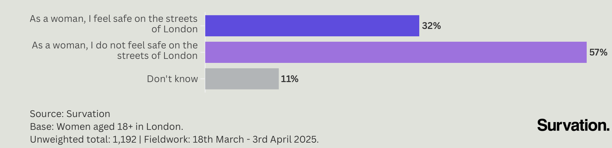

## Investigation

'What are the safest routes for women walking home at night in London?'

A study conducted in April 2025 by ITV Survation found that 57% of women do not feel safe on the streets of London, and this was particularly high among women aged 18 to 24. This lack of safety is further heightened when travelling at night. Therefore, we decided to investigate which are the safest routes for women walking home in London, on their way home from a night out. This project investigated routes from night clubs to nearest bus stops and tube stations. We have mapped these routes for 3 popular night out locations in London: Bermondsey, Dalston, and Hackney Wick.

## Routes home in Dalston

## Routes home in Bermondsey

## Routes home in Hackney Wick

INSERT IMAGE FOR HACKNEY WICK

Hackney Wick demonstrates relatively strong safety outcomes across the board, with all routes achieving safety scores above 56 and displaying predominantly green colouring on our visualisation. MOTH Club shows particularly safe routes, with three destinations achieving safety scores above 89 and zero recorded crimes—these routes to Hackney Town Hall, Hackney Central/Mare Street stop, and Hackney Central station represent the safest options in the area. However, within this generally safe context, there are still notable variations worth considering. Routes involving Mare Street show moderately lower safety scores compared to other areas, with The Glove That Fits' route to Mare Street/Narrow Way recording 69 crimes (safety score 63.41) and routes to Mare Street/Well Street showing 33 crimes each (safety scores 60.38 and 56.59). The most significant finding is MOTH Club's route to Trelawney Estate, which despite being extremely short (0.043 km), recorded 19 crimes resulting in a safety score of 40.00 due to very high crime density (883.72 crimes per km). This suggests a localised crime hotspot rather than a dangerous extended corridor. Overall, Hackney Wick offers relatively safe routes for women walking home at night, with most options scoring in the 70-90 range. The visualisation shows this area performs comparably to Dalston and better than several Bermondsey locations, making it a reasonably safe area for nighttime travel.

## Area Comparison

INSERT BAR CHART IMAGE

The routes in these three areas in London vary in safety level. While all three demonstrate reasonably safe routes overall, there are some notable differences. Dalston shows the most consistent performance, with club averages ranging from 72-79 and a substantial amount of routes recording zero crimes. Five of Dalston's eight clubs scored between 76-78, suggesting reliable safety across most nighttime walking routes in the area. Hackney Wick, despite having fewer clubs (4) and routes (13) due to its smaller nightlife scene, performs comparably well with three clubs averaging above 73. MOTH Club achieved the highest individual club average (78.27) across all three areas, though The Glove That Fits (69.04) indicates that even within Hackney Wick, route choice matters. Bermondsey presents a more mixed picture, with club averages ranging more widely from 57-77. While several Bermondsey clubs like The Barrel Project (77.20) and N1 Bar (76.70) perform as well as their counterparts in other areas, two clubs - Bermondsey Arts Club (57.44) and Bermondsey Bierkeller (60.27) - show notably lower averages. The visualisation reflects this variation, with Bermondsey displaying a wider spectrum of colours from red through yellow to green, while Dalston and Hackney Wick show predominantly green bars. Across all three areas, most routes fall within the 60-80 safety score range, indicating that women walking home from nightclubs generally face moderate rather than severe safety risks. However, the data suggests that route selection is particularly important in Bermondsey, somewhat important in Hackney Wick (especially for routes from The Glove That Fits), and less critical but still relevant in Dalston where most routes perform well.

## Interactive Route Safety Map

INSERT INTERACTIVE MAP

## Credits

Eli Moss-Marks - [Eli](https://github.com/elimossmarks11): Data Collection and READ.me

Ariana Alexander - [Ariana](https://github.com/ariana-alexander): TfL Data and Data Transformation 

Deyaan Mistry - [Deyaan](https://github.com/DeyaanMistry): Data Analysis and Visualisations

Together: project brainstorming and decision-making; creation of website
