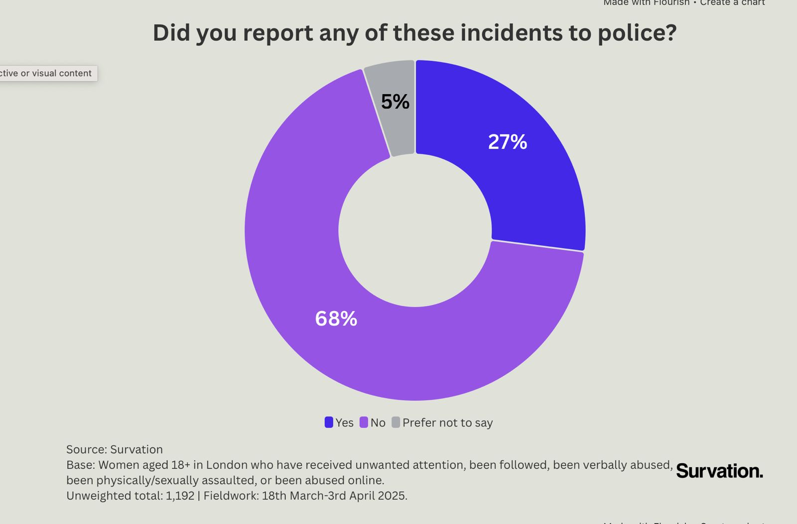

## Curiosity-Driven Exploratory Question
'What are the safest routes for women walking home at night in London?'

## Justification of Data Source Choice

**UK Police API** ➡️ provides the area/road segement for street crimes (filter for crimes under 'violence and sexual offences' category, which women are disproportionately victim to). Query with force-level parameters (filtering for crimes reported by only the City of London Police and the Metropolitan Police) for data on just London. 

**Google API** ➡️ use the Google Area Insights API identify popular night out locations in London (from which may women start their journeys home at night) as well as the Google Places API to collect data on shops number and location of shops open after 23:00. 

## Technical Implementation Plan

## Work Distribution Strategy

## Risk Mitigation Strategies

| Risk | Mitigation Strategy |
|:--------:|:-------------------:|
| Google API has costs above 10,000 billable events | Store non time-dependent data locally (e.g. locations) |
| Cases of violence and sexual offences are notoriously underreported | This trend is not area-dependent and will not skew comparison between areas. |
| Police API data is declared monthly | Our findings will be presented as a risk indicator, not a guarantee. |
| Safest routes might be unreasonably long | Impose a duration cap, present these routes as 'balanced' |

